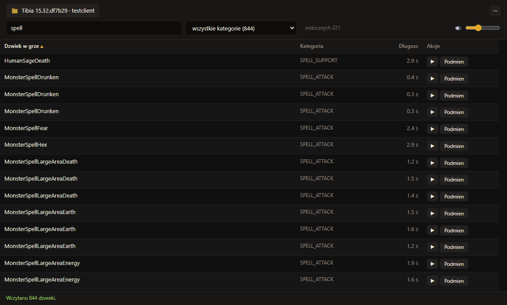
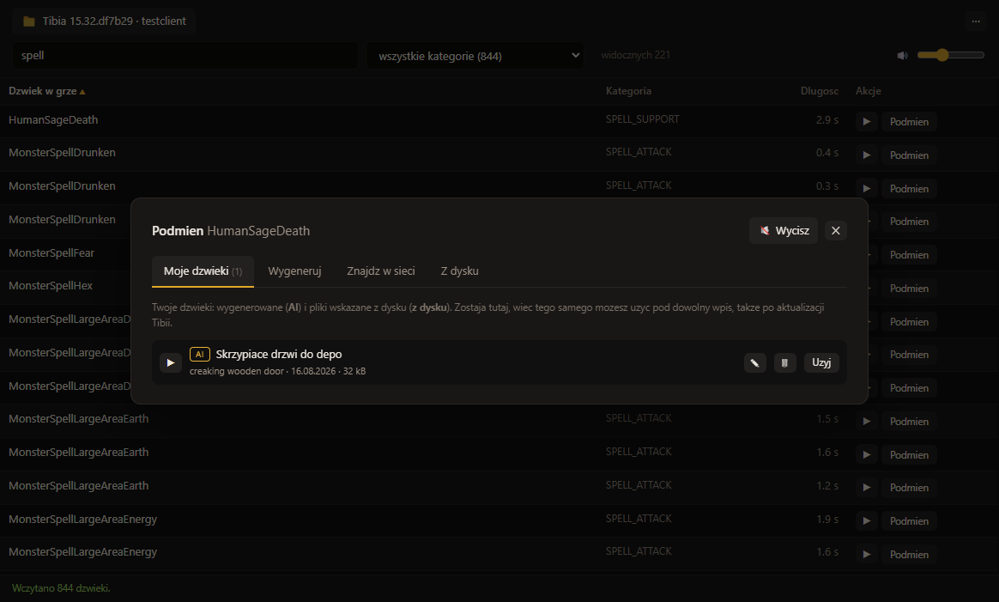

# Tibia Sounds Config

Browse and replace the Tibia client's sound files. Each of the ~844 files carries a readable
in-game action name, so you know what you are actually changing.

> **The application interface is in Polish.** The documentation is in English. Polish button
> and menu labels are quoted below so you can find them on screen.

- **Preview** any sound without launching the game.
- **Replace** it with your own file (mp3, wav, flac, m4a&hellip;), **mute** it, or **restore the
  original**. The app always keeps a backup.
- **Find one online**: type "big explosion", listen to the results, replace. The built-in
  sources return CC0 licensed files only.
- **Generate from a description**: "deep dragon roar with echo". Optional, needs your own
  API key, off by default.
- **Sound sets**: mute all the music or keep only combat sounds with one click. Your own
  layouts are saved under a name.
- **Update from inside the app**: the menu checks whether a newer release exists, downloads
  the installer and verifies its checksum. The version check runs only when you click,
  unless you enable the once-a-day check yourself.

Everything you use, meaning generated sounds and files picked from disk, stays in the
library, so you can apply the same sound to another entry without hunting for the file again.

> **Before you use it.** This is a purely cosmetic change: you hear something else and the
> game behaves the same. CipSoft supports the Tibia client only in its original state, so
> every modification of its files is at your own risk. There is always a way back: a button
> in the app, or file verification in the Tibia launcher.

## Installation

Download from [Releases](https://github.com/Mysttic/tibia-sounds-config/releases):

| file | for whom |
|---|---|
| `...-setup.exe` | installer: shortcuts on the desktop and in the Start menu |
| `...-portable.exe` | a single file, no installation, runs from a USB stick |
| `...-win-x64.zip` | the same as portable, in an archive, when your browser makes `.exe` downloads difficult |

Replacing and muting also need the free [ffmpeg](https://ffmpeg.org/download.html).
Without it, browsing and previewing still work.

Windows will show *"Windows protected your PC"*, meaning **More info** then **Run anyway**.
The files are not signed with a publisher certificate; how to check what you downloaded is
described in the [FAQ](docs/FAQ.md#installation).

## How to use it

1. The app finds the client in `%LOCALAPPDATA%\Tibia` on its own. The button in the top bar
   shows which installation you are using, and clicking it points at another one.
2. Search by action name, category or id, for example `raid`. The <kbd>/</kbd> key moves the
   cursor to the search box.
3. **&#9654;** plays a sound, a second click (or <kbd>Esc</kbd>) stops it.
4. **Podmien** opens a window with four sources. A file can also be dragged straight onto a
   row without opening the window.
5. Right-clicking a row opens the remaining actions: show the file in Explorer, copy the id.

A dot next to the name marks a sound that is no longer the original. The counters above the
list double as filters. Before every change the app checks whether Tibia is running and
refuses to write if it is.

**After a Tibia update** the launcher restores the original sounds. That is normal. The app
detects it and shows a *"Tibia przywrocila N Twoich dzwiekow"* bar with a **Przywroc moje**
button.

## More

| | |
|---|---|
| questions and doubts (bans, backups, licensing, network) | [docs/FAQ.md](docs/FAQ.md) |
| what exactly happens to your files | [docs/HOW_IT_WORKS.md](docs/HOW_IT_WORKS.md) |
| running from source, building it yourself | [docs/DEVELOPMENT.md](docs/DEVELOPMENT.md) |
| the Tibia client data format | [docs/SOUND_FORMAT.md](docs/SOUND_FORMAT.md) |
| change history | [CHANGELOG.md](CHANGELOG.md) |
| reporting security problems | [SECURITY.md](SECURITY.md) |

## What this project does and does not do

It replaces selected `.ogg` files in the Tibia client with alternative audio of the same
name and format. That is all.

It does **not** modify the client executable, `.dat` files or asset catalogs. It does not
inject code, hook the game process or read its memory, so it does not communicate with the
game in any way. It does not alter gameplay, timing or the information available to the
player, and it provides no advantage over other players. It sends no data about you: no
telemetry, no account. It connects to the network only when you search for a sound, enable
generation, or check for updates.

Replacement audio keeps the **original's sample rate and channel count**, because every file
from disk is re-encoded to match, so the engine receives exactly what it expects. Before the
first replacement of any sound, the app stores a backup of the original, so going back is
always possible.

## Disclaimer

An unofficial fan project. **Not affiliated with or endorsed by CipSoft GmbH.** The Tibia
client is provided and supported by CipSoft only in its original, unmodified state. Any
modification of its files is done **entirely at your own risk**; the author takes no
responsibility for technical issues or any consequences of using this project.

[MIT](LICENSE). Tibia is a trademark of CipSoft GmbH; this project **contains no game files**
and works on the sounds from your own installation.
