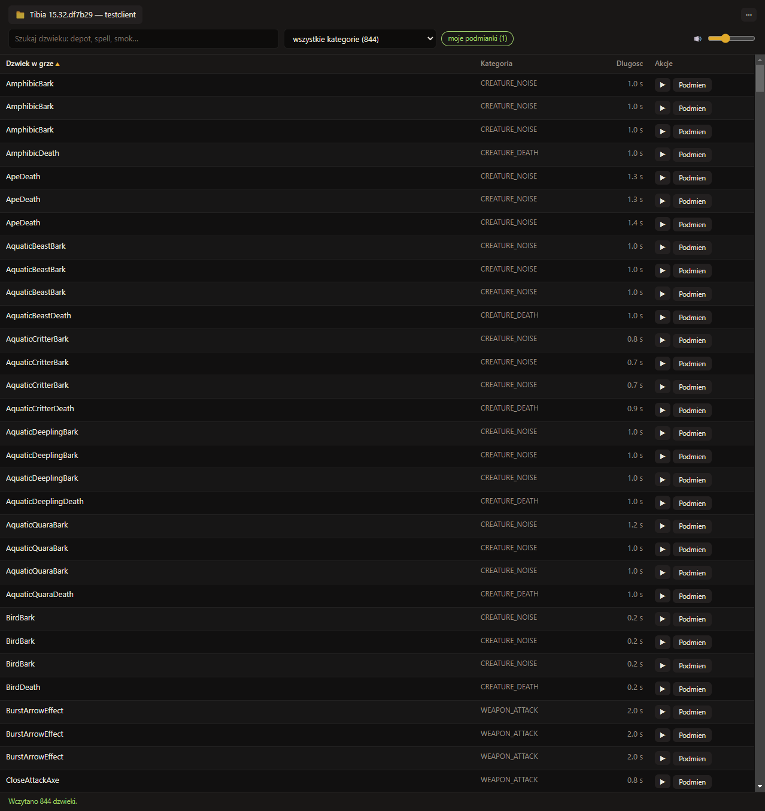
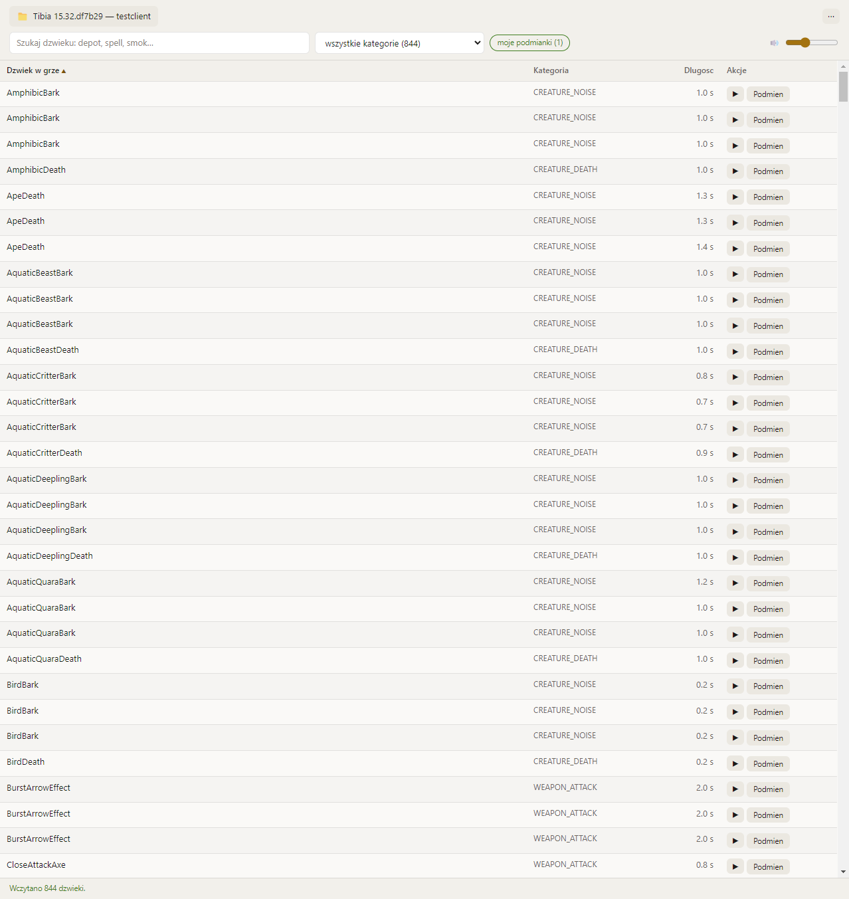
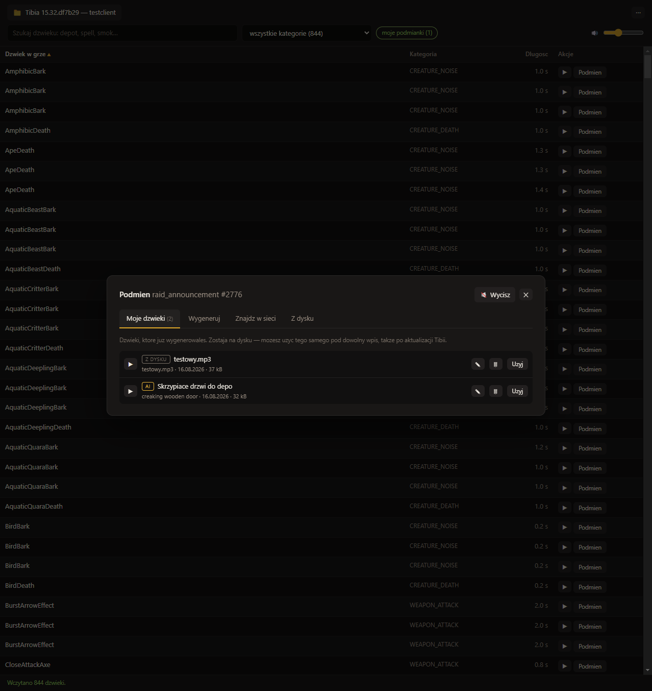

# How it works and what exactly it does to your files

This page is for people who want to know what the app does to their computer before they
trust it. No jargon where it can be avoided, specifics where they are needed.

## What it looks like

By default the app follows the Windows theme. You can override that in the menu
(the **&#8943;** button in the top right corner), in the *Wyglad* row: **Auto**, **Jasny**
or **Ciemny**. The change is immediate and the menu stays open, so you can compare the
variants with one click, and the choice is remembered until the next launch.

| dark | light |
|---|---|
|  |  |

The application interface is in Polish; this documentation is in English.

## Where Tibia keeps its sounds

The Tibia client keeps every sound as a separate file in its own directory:

```
C:\Users\<you>\AppData\Local\Tibia\packages\Tibia\sounds\
    sound-0ded20f6...ogg     <- a single sound (there are about 844)
    sound-736ee634...ogg
    ...
    sounds-ce31d979...dat    <- the "table of contents": which sound id is which file
    catalog-sound.json
```

The file names look like random strings, but each of them means something, as described
below. The information about which sound belongs to which in-game event (a spell, a monster,
a raid) is stored inside the client's files; the app reads it from there and shows it as
readable names in the table.

## Why this does not affect the game

The client's sound layer is **passive**: a set of `.ogg` files plus a
`sounds-<sha256>.dat` index saying which file belongs to which event. The engine plays a
file when the event happens. Nothing in that layer decides **whether** or **when** an event
happens, because that is settled by the game and the server.

Concrete consequences:

- **We only replace the contents of `.ogg` files.** The `.dat` index is untouched and so
  are the file names, so the event to sound mapping is exactly the same as before.
- **The format is preserved.** Every file entering the client is re-encoded to the original's
  sample rate and channel count, so the engine gets what it expects.
- **A different sound length changes nothing in the game.** A sound is not a clock: the game
  does not wait for it to end and does not measure anything with it.
- **The app has no contact with the running game.** It does not inject code, does not hook
  into the process, and neither reads nor writes its memory. It works on files on disk, and
  only while the client is closed. Before every write it checks whether Tibia is running and
  refuses if it is.
- **It gives no advantage.** No information available to the player changes; only the sound
  of what you would have heard anyway.

That is also why the Tibia launcher **restores the original sounds** when it verifies files,
and that is your guaranteed way back, regardless of what the app has in its own notes.
More about that in the section on updates below.

## Places where the app writes anything

| place | what and when |
|---|---|
| `<client>\packages\Tibia\sounds\sound-*.ogg` | the sound being replaced, muted or restored, only when you click |
| `%APPDATA%\Tibia Sounds Config\vault\` | backups of originals, your replacements and a cache of file fingerprints (`hashcache.json`) |
| `%APPDATA%\Tibia Sounds Config\settings.json` | the client path and small settings |
| `%APPDATA%\Tibia Sounds Config\secrets.json` | your API key, **encrypted**, only if you enable generation |
| `%APPDATA%\Tibia Sounds Config\generated\` | your generated sounds, they stay until you delete them |
| `%APPDATA%\Tibia Sounds Config\presets.json` | your own sound sets (rules only, no audio) |
| a place you choose yourself | only for **Zapisz kopie moich podmianek**: writing a JSON file into a folder you pick |

What the app **never** does:

- it does not modify program files (`.exe`, `.dll`), game data (`.dat`, `assets.json`) or
  any files outside the list above,
- it does not touch the Windows registry (beyond the standard installer entries),
- it does not send any data about you: no telemetry, no statistics, no account,
- it does not install services, does not add itself to startup, and leaves nothing running
  after the window is closed,
- it neither reads nor modifies the memory of the running game. Before every change to files
  it also checks whether the Tibia client process (`client.exe` / `Tibia.exe`) is running.
  If it is, it refuses to write and asks you to close the game.

One extra technical safeguard: **into the client directory** the app writes only files whose
name matches the pattern `sound-<64 hex characters>.ogg` (plus a temporary working file next
to it, used for safe writing, see below). Because of that, even a bug in the program cannot
overwrite anything outside the sounds directory.

## When the app connects to the internet

By default it does not connect at all. Network traffic appears **only** when you click
*Szukaj*, *Wygeneruj* or *Uzyj* in the sound replacement window, or *Sprawdz aktualizacje*
in the menu. Nothing sends statistics or telemetry, and the only background request is the
version check, which you can enable yourself and which is off by default.

When that happens, the app queries:

| address | what for |
|---|---|
| `api.openverse.org` | searching for CC0 licensed sounds |
| `cdn.freesound.org` | previewing and downloading a file found through Openverse |
| `archive.org` | searching curated CC0 collections |
| `api.elevenlabs.io` | only if you enable effect generation and paste your key |
| `openrouter.ai` | only if you enable speech generation and paste your key |
| `api.github.com` | checking whether a newer release exists |
| `objects.githubusercontent.com` | downloading the update installer |
| an address you supply | a custom source or a pasted link |

Safeguards on that path:

- **`https` only**: `http`, `file` and `data` addresses are rejected,
- **a 25 MB limit** on downloaded files, enforced during the download rather than after it,
- a downloaded file **never reaches the game in its original form**, it always goes through
  ffmpeg and is re-encoded, exactly like a file from disk,
- all traffic leaves from the main process; the app window **has no network access**, and it
  receives previews through keys rather than addresses (it sees a result's address together
  with the search result, but has no way to connect to it).

Built-in sources are filtered hard to the **CC0** license (public domain, no attribution
required). Internet Archive is additionally restricted to two collections that are CC0 in
their entirety. Without that restriction the results would include recordings with no
license at all. Where each downloaded sound came from is recorded in `profile.json`
(author, license, source page address).

## Updates from inside the app

The menu has *Sprawdz aktualizacje*. The app then asks GitHub's public API about the newest
release of this project, compares the number with the version you have, and if a newer one
exists, offers to download the installer. Next to it is a *Sprawdzaj sam* toggle,
**off by default**: once enabled, the app will ask at most once a day, a few seconds after
startup. The request carries nothing beyond what every https server sees, and it needs
neither an account nor a token.

What happens after you click *Pobierz i zainstaluj*:

1. The file address **does not come from the app window**. The main process remembers what
   it found during the last check and can download only that; the renderer has no way to
   make it fetch something from an arbitrary address.
2. The download follows the same path as any other file from the network: `https` only, a
   size limit enforced during the transfer, a timeout.
3. The downloaded file is checked by size and by the **SHA-256 sum** that GitHub publishes
   alongside the asset. If it does not match, the file is discarded and nothing is run.
4. Only after your confirmation does the app run the installer silently (`/S`) and exit.
   The installer knows the directory from the previous installation, so it installs into the
   same place; your settings and vault are left untouched.

What that checksum does **not** mean: it arrives in the same response as the file address,
so it is not an independent proof of provenance. It protects against a corrupted or
truncated download, not against a compromised publisher account. If you want a stronger
guarantee, every release description contains a `gh attestation verify` command that checks
the file was built from a specific commit by GitHub Actions.

**The portable build and the unpacked zip do not update themselves.** The installer would
put a second copy somewhere else while the directory the program is running from stayed old.
The app detects this and shows a link to the release page instead of an install button.

## Sound generation and your API key

This is the only feature that requires an account somewhere else. It is **inactive by
default**: until you paste a key, nothing happens.

The app **has no key of its own and pays for nothing**. Generation is billed to your account
with the provider, according to their pricing.

What happens to the key:

- it is stored through the system's **safeStorage** (on Windows this rests on DPAPI, meaning
  encryption with your system account key), so the file holds ciphertext, not the key,
- if the system offers no encryption, the app **refuses to save** rather than writing the key
  in plain text,
- the key never leaves the main process. The app window can at most ask *whether* a key is
  set; it never receives it,
- copying `secrets.json` to another computer achieves nothing: the ciphertext cannot be read
  there, and the app will treat it as a missing key.

## Your own sound library

A generated sound goes straight into the **Moje dzwieki** tab and **stays there permanently**.
You can play it, give it your own name, use it for any entry and reuse it for another one
without paying twice for the same thing. It disappears only when you delete it.

We keep the file **exactly as the provider returned it** (usually mp3), not a converted
version. The reason is practical: conversion to the game format depends on the sound you are
replacing, and each one has its own `sampleRate` and channel count. Had we stored a finished
`.ogg`, the same generated sound could not be used correctly for a different entry. So the
conversion happens on every use, always from the original.

The library is **independent of the client**: it survives Tibia updates, version changes and
pointing the app at a different installation.

A sound reaches the client only after you click *Uzyj*, along the same path as a file from
disk: a backup of the original, conversion with ffmpeg, an atomic write.

**Files selected from disk** land in the library too, marked as *z dysku* as opposed to
generated ones (*AI*). Thanks to that, a file used once can be applied to another sound
without hunting for it again. Files larger than 25 MB and files that are not audio are
skipped; the replacement itself works normally.



**The license depends on your plan with the provider**, not on us. The free ElevenLabs plan
grants no commercial license and requires attribution. For replacing sounds privately in your
own client this makes no difference, but the app does not know your plan and will not settle
it for you. The provenance of every generated sound (provider, model, your prompt) is recorded
in `profile.json`.

You can also add a **custom source** or paste a direct link to a file. In that case it is on
you to check that service's terms and licensing, because the app verifies nothing and
deliberately ships no ready-made definitions for sites whose terms forbid automated downloads.

## Sound sets (presets)

A set is **rules, not files**. It contains no audio, weighs a few hundred bytes, and only
says what should be muted, what should be left original, and what should be replaced with a
sound from your library. You pick one from the list in the menu, under *Zestawy dzwiekow*.

The key principle: **the last matching rule wins**. Without it there would be no concise way
to write "mute everything except weapons"; you would have to list several hundred
identifiers. The *Cicho, tylko walka* set is two rules in its entirety:

```
1. everything                        -> silence
2. WEAPON_ATTACK, SPELL_ATTACK       -> original
```

Sounds that **no rule touches stay untouched**. That is why *Bez muzyki* mutes the music and
leaves your other replacements alone.

Before applying a set, the app shows in the row exactly what it will do: how many it will
mute, how many it will restore, how many it will leave unchanged. Then it waits for
confirmation.

**Your own sets** are created with the *Zapisz obecny uklad* button: the app turns the
current state of the catalog into rules. They live in
`%APPDATA%\Tibia Sounds Config\presets.json`. The five built-in sets cannot be changed or
deleted.

### Why this is fast

Muting several hundred sounds could mean several hundred ffmpeg invocations. It does not,
because silence with given parameters is always identical: we generate it **once per
combination of `sampleRate` and channel count** and share it across all the sounds. In the
real client 15.32 bank there are only two such combinations (44100 Hz / 2 channels for 758
sounds and 48000 Hz / 2 channels for 86), so instead of 844 conversions there are two, and
the rest is copying files.

The profile is saved in one go rather than after every file. An error on a single sound does
not abort the batch; it lands on a list of skipped entries and is reported.

Writing several hundred files takes a while, so the check for whether the game is closed
**repeats during the operation** rather than only at the start. If Tibia starts up halfway
through, the batch is aborted and whatever was already done is saved.

### What a set cannot replace

Replacements made from files that are not in the library cannot be recreated by a rule,
because there is nothing to refer to. Moving your own sounds to another computer is still
the job of **profile export**, which carries the audio itself.

## How it knows what is original: a fingerprint in the file name

This is the most important mechanism in the whole app and the reason it does not have to
"track" anything.

CipSoft names every sound file after its own **fingerprint** (a SHA-256 sum, a mathematical
digest of the file's contents; changing one byte changes the digest completely). So the file
`sound-0ded20f6...ogg` has its expected original content written into its name.

The app therefore computes the fingerprint of every file on disk and compares it with the name:

- **it matches**, so the original is untouched,
- **it does not match**, so someone replaced it (you, this app, or anything else).

That *original / changed* distinction follows from the files themselves, so it works even if
you replace something by hand in Explorer or delete the app's data. (For speed, fingerprints
are cached and recomputed when a file's size or modification date changes. The typical 844
files come to about 110 MB, and hashing all of it on every start would take a while.)

On top of that comes the app's own notebook (`profile.json` in the vault), where it records
**what it did itself**. Combining the two produces the *Status* column:

| status | what it means |
|---|---|
| `oryginal` | the file matches the fingerprint in its name, untouched |
| `podmieniony` | your replacement, applied by this app, in place |
| `nadpisany przez launcher` | the replacement reverted to the original, usually after the Tibia launcher verified the files, see below |
| `obcy` | the file differs from the original but the app has no record of it (for example a manual replacement) |
| `brak pliku` | the client lists a sound that is not on disk |

One caveat: the *"my replacement"* versus *"foreign"* distinction rests on the notebook. If
you delete the app's data folder or move the client elsewhere, your earlier replacements will
show as `obcy` and restoring from the vault will stop working (the launcher verification
remains, see below). Detecting that a file is not the original always works.

## Backups (the vault)

Before the app overwrites a sound for the first time, it puts the original into:

```
%APPDATA%\Tibia Sounds Config\vault\clients\<installation-name>\
    originals\    <- original files, exactly as they came from the game
    library\      <- your replacements after conversion to the game format
    profile.json  <- the notebook: what was replaced, when, and with what
```

Every client installation (for example the main one and a test one) gets its own folder, so
the backups never mix. The backup of an original is verified by fingerprint both when saving
and when restoring, so a corrupted backup will never be written into the game.

Without a replacement, an original **is never irreversibly overwritten**. If a backup were
missing, the Tibia launcher will fetch the original from CipSoft's server when it verifies
files (the app cannot, because the server rejects downloads from outside the launcher).

## What happens during a replacement, step by step

1. If the vault has no backup of the original yet, the app puts one there (and verifies by
   fingerprint that it really is the original).
2. Your file (mp3/wav/flac/&hellip;) is converted with ffmpeg into the format the game uses,
   matching the technical parameters (sample rate, channel count) to the original, so the
   game engine receives exactly the kind of file it expects. The volume stays as your
   recording has it, because the app does not normalize it, so a very loud file will be loud
   in the game too. Metadata (title, artist) is stripped.
3. The converted file lands in `library\` in the vault and is then **atomically** put in the
   original's place (first written next to it, then renamed in an instant, so there is no
   moment where the file is half written).
4. `profile.json` gains an entry with the replacement's fingerprint, which is how the app
   later tells its own replacement from someone else's.

**Muting** works the same way, except that instead of your file it inserts 0.05 seconds of
silence with the original's parameters.

**Restoring** copies the original back from the vault (after checking the fingerprint) and
removes the entry from the notebook. The app also recognizes manual backups following the
`___sound-<fingerprint>.ogg` convention placed next to the file, so if you ever made a
backup by hand, it can use it.

## What happens after a Tibia update

On every patch the Tibia launcher compares files against its own checklist and **overwrites
everything that differs**, so your replacements disappear. That is built-in game behaviour,
not a bug.

The app sees this (the file matches the fingerprint in its name again, but the notebook has
an entry about a replacement, giving the status `nadpisany przez launcher`) and shows a bar
above the list with a **Przywroc moje** button, which reapplies the replacements from `library\`.

There is an upside: **verifying files in the launcher always restores the client to a 100%
factory state**, no matter what was changed or how.

## How to remove the app and every trace of it

1. In the app, click **Przywroc** on every replaced sound (or simply run the Tibia launcher,
   whose verification does the same thing).
2. Uninstall the app (or delete the portable file).
3. Delete the `%APPDATA%\Tibia Sounds Config` folder. The installer deliberately does **not**
   remove it, so that your backups of originals are not destroyed without asking.

After those three steps nothing is left on the computer.

## For the curious

- Client data format, the full list of actions and statistics: [SOUND_FORMAT.md](SOUND_FORMAT.md)
- App architecture and the technical details of the safeguards: [ARCHITECTURE.md](ARCHITECTURE.md)
- Running from source and building it yourself: [DEVELOPMENT.md](DEVELOPMENT.md)
