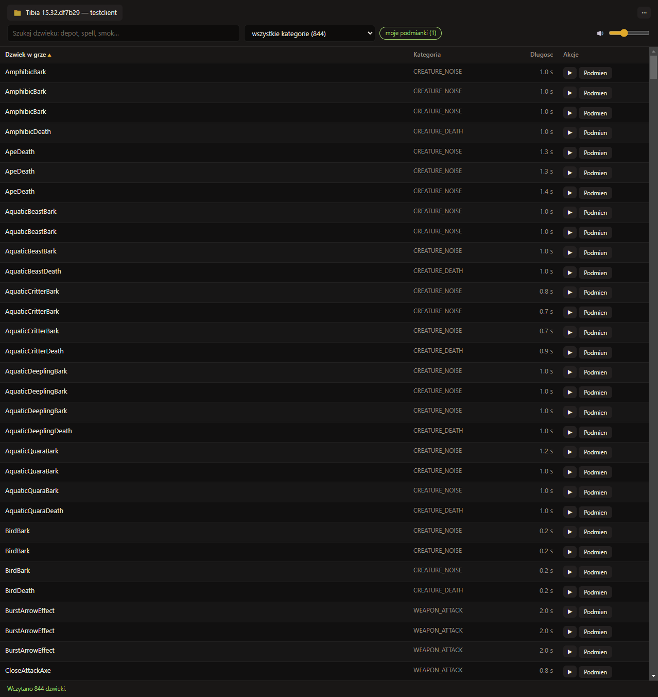
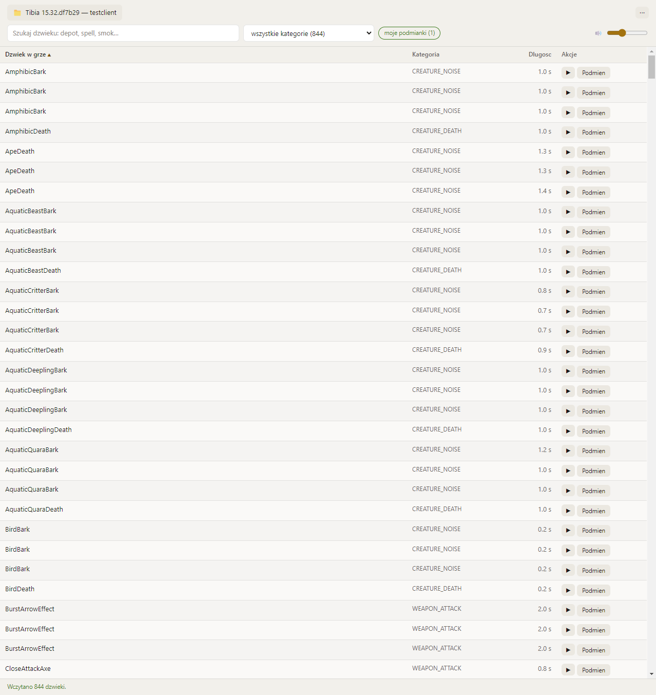
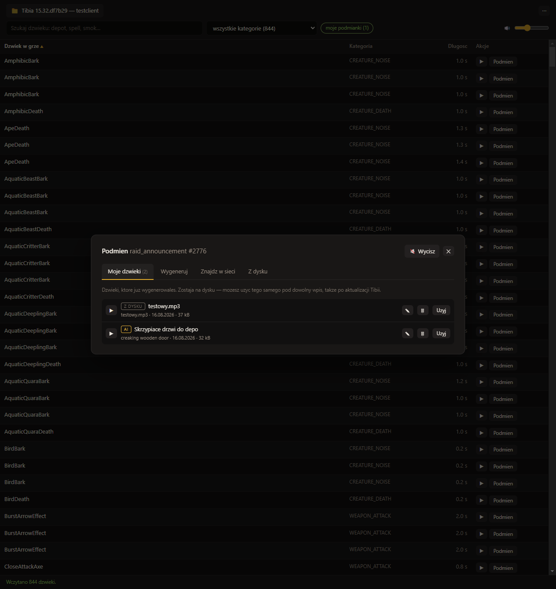

# Jak to dziala i co dokladnie robi z plikami

Ta strona jest dla osob, ktore chca wiedziec, co aplikacja robi z ich komputerem,
zanim jej zaufaja. Bez zargonu tam, gdzie sie da; z konkretami tam, gdzie trzeba.

## Jak to wyglada

Domyslnie aplikacja podaza za motywem Windowsa. Mozesz to nadpisac w menu
(przycisk **&#8943;** w prawym gornym rogu), w wierszu *Wyglad*: **Auto**, **Jasny**
lub **Ciemny**. Zmiana dziala natychmiast, menu zostaje otwarte, wiec da sie porownac
warianty jednym klikni&#281;ciem, a wybor jest zapamietywany do nastepnego uruchomienia.

| ciemny | jasny |
|---|---|
|  |  |

## Gdzie mieszkaja dzwieki Tibii

Klient Tibii trzyma wszystkie dzwieki jako osobne pliki w swoim katalogu:

```
C:\Users\<ty>\AppData\Local\Tibia\packages\Tibia\sounds\
    sound-0ded20f6...ogg     <- pojedynczy dzwiek (jest ich ~844)
    sound-736ee634...ogg
    ...
    sounds-ce31d979...dat    <- "spis tresci": ktory numer dzwieku to ktory plik
    catalog-sound.json
```

Nazwy plikow wygladaja jak losowe ciagi, ale kazda z nich cos znaczy, o czym nizej.
Informacja, ktory dzwiek odpowiada za jakie zdarzenie w grze (czar, potwor, raid),
jest zapisana wewnatrz plikow klienta; aplikacja ja stamtad odczytuje i pokazuje
jako czytelne nazwy w tabeli.

## Dlaczego to nie wplywa na gre

Warstwa dzwiekowa klienta jest **pasywna**: to zbior plikow `.ogg` plus indeks
`sounds-<sha256>.dat`, ktory mowi, ktory plik odpowiada ktoremu zdarzeniu. Silnik
odtwarza plik, gdy zdarzenie nastapi. Nic w tej warstwie nie decyduje o tym, **czy**
i **kiedy** zdarzenie nastapi, bo to rozstrzyga sie po stronie gry i serwera.

Stad konkretne konsekwencje:

- **Podmieniamy wylacznie zawartosc plikow `.ogg`.** Indeks `.dat` zostaje nietkniety,
  nazwy plikow tez, wiec przypisanie "zdarzenie &rarr; dzwiek" jest dokladnie takie samo
  jak przed podmiana.
- **Format jest zachowany.** Kazdy plik wchodzacy do klienta jest przekodowywany do
  czestotliwosci probkowania i liczby kanalow oryginalu, wiec silnik dostaje to,
  czego oczekuje.
- **Inna dlugosc dzwieku nie zmienia niczego w grze.** Dzwiek nie jest zegarem:
  gra nie czeka na jego koniec i nie odmierza nim zadnych czasow.
- **Aplikacja nie ma zadnego kontaktu z uruchomiona gra.** Nie wstrzykuje kodu, nie
  podpina sie do procesu, nie czyta ani nie zapisuje jego pamieci. Pracuje na plikach
  na dysku, i to wylacznie wtedy, gdy klient jest zamkniety. Przed kazdym zapisem
  sprawdza, czy Tibia nie jest uruchomiona, i odmawia, jesli jest.
- **Nie daje przewagi.** Zadna informacja dostepna graczowi sie nie zmienia; zmienia sie
  tylko brzmienie tego, co i tak by uslyszal.

Dlatego tez launcher Tibii przy weryfikacji plikow **przywraca oryginalne dzwieki**,
i to jest Twoja gwarantowana droga powrotu, niezaleznie od tego, co aplikacja ma zapisane
w swoich notatkach. Wiecej o tym w sekcji o aktualizacjach nizej.

## Miejsca, w ktorych aplikacja cokolwiek zapisuje

| miejsce | co i kiedy |
|---|---|
| `<klient>\packages\Tibia\sounds\sound-*.ogg` | podmieniany/wyciszany/przywracany dzwiek, tylko gdy klikniesz |
| `%APPDATA%\Tibia Sounds Config\vault\` | kopie oryginalow, Twoje podmianki i podreczny spis odciskow plikow (`hashcache.json`) |
| `%APPDATA%\Tibia Sounds Config\settings.json` | sciezka klienta i drobne ustawienia |
| `%APPDATA%\Tibia Sounds Config\secrets.json` | Twoj klucz API, **zaszyfrowany**, tylko jesli wlaczysz generowanie |
| `%APPDATA%\Tibia Sounds Config\generated\` | Twoje wygenerowane dzwieki, zostaja do czasu, az sam je usuniesz |
| `%APPDATA%\Tibia Sounds Config\presets.json` | Twoje wlasne zestawy dzwiekow (same reguly, bez audio) |
| miejsce, ktore sam wskazesz | tylko przy **Zapisz kopie moich podmianek**: zapis pliku JSON w wybranym przez Ciebie folderze |

Czego aplikacja **nigdy** nie robi:

- nie modyfikuje plikow programu (`.exe`, `.dll`), danych gry (`.dat`, `assets.json`)
  ani zadnych innych plikow poza lista wyzej,
- nie dotyka rejestru Windows (poza standardowymi wpisami instalatora),
- nie wysyla o Tobie zadnych danych: zero telemetrii, zero statystyk, zero konta,
- nie instaluje uslug, nie dodaje sie do autostartu, nie zostawia niczego
  dzialajacego po zamknieciu okna,
- nie czyta ani nie modyfikuje pamieci dzialajacej gry. Przed kazda zmiana w plikach
  sprawdza tez, czy proces klienta Tibii (`client.exe` / `Tibia.exe`) jest uruchomiony.
  Jesli tak, odmawia zapisu i prosi o zamkniecie gry.

Dodatkowe zabezpieczenie techniczne: **do katalogu klienta** aplikacja zapisuje
wylacznie pliki o nazwie pasujacej do wzorca `sound-<64 znaki hex>.ogg` (plus
chwilowy plik roboczy obok, uzywany do bezpiecznego zapisu, patrz nizej).
Nawet blad w programie nie moze przez to nadpisac niczego poza katalogiem dzwiekow.

## Kiedy aplikacja laczy sie z internetem

Domyslnie nie laczy sie wcale. Ruch sieciowy pojawia sie **wylacznie** wtedy, gdy sam
klikniesz *Szukaj*, *Wygeneruj* albo *Uzyj* w oknie podmiany dzwieku. Nie ma zadnego
odpytywania w tle, sprawdzania aktualizacji ani wysylania statystyk.

Wtedy aplikacja odpytuje:

| adres | po co |
|---|---|
| `api.openverse.org` | wyszukiwanie dzwiekow na licencji CC0 |
| `cdn.freesound.org` | odsluch i pobranie pliku znalezionego przez Openverse |
| `archive.org` | wyszukiwanie w kuratorowanych kolekcjach CC0 |
| `api.elevenlabs.io` | tylko jesli wlaczysz generowanie efektow i wkleisz swoj klucz |
| `openrouter.ai` | tylko jesli wlaczysz generowanie mowy i wkleisz swoj klucz |
| adres, ktory sam podasz | wlasne zrodlo lub wklejony link |

Zabezpieczenia tej sciezki:

- **tylko `https`**: adresy `http`, `file` czy `data` sa odrzucane,
- **limit 25 MB** na pobierany plik, przerywany w trakcie, a nie po fakcie,
- pobrany plik **nigdy nie trafia do gry w oryginalnej postaci**, zawsze przechodzi
  przez ffmpeg i jest przekodowany, tak samo jak plik z dysku,
- caly ruch idzie z procesu glownego; okno aplikacji **nie ma dostepu do sieci**, a odsluch
  dostaje przez klucze, nie przez adresy (adres wyniku widzi razem z wynikiem wyszukiwania,
  ale nie ma jak sie z nim polaczyc).

Wbudowane zrodla sa filtrowane twardo do licencji **CC0** (domena publiczna, bez wymogu
podawania autora). Internet Archive jest dodatkowo ograniczony do dwoch kolekcji, ktore
w calosci sa CC0. Bez tego ograniczenia w wynikach pojawialyby sie nagrania bez
zadnej licencji. Skad pochodzi kazdy pobrany dzwiek, zapisujemy w `profile.json`
(autor, licencja, adres strony zrodlowej).

## Generowanie dzwieku i Twoj klucz API

To jedyna funkcja aplikacji, ktora wymaga konta u kogos innego. Jest **domyslnie
nieaktywna**: dopoki nie wkleisz klucza, nie dzieje sie nic.

Aplikacja **nie ma wlasnego klucza i za nic nie placi**. Generowanie obciaza Twoje konto
u dostawcy, wedlug jego cennika.

Co dzieje sie z kluczem:

- zapisujemy go przez **safeStorage** systemu (na Windows opiera sie o DPAPI, czyli
  szyfrowanie kluczem Twojego konta w systemie), wiec w pliku lezy szyfrogram, nie klucz,
- jesli system nie udostepnia szyfrowania, aplikacja **odmawia zapisu** zamiast zapisac
  klucz jawnym tekstem,
- klucz nigdy nie opuszcza procesu glownego. Okno aplikacji moze co najwyzej zapytac,
  *czy* klucz jest ustawiony, ale nigdy go nie dostaje,
- skopiowanie `secrets.json` na inny komputer nic nie da: szyfrogramu nie da sie tam
  odczytac, a aplikacja potraktuje to jak brak klucza.

## Biblioteka wlasnych dzwiekow

Wygenerowany dzwiek trafia od razu do zakladki **Moje dzwieki** i **zostaje tam na stale**.
Mozesz go odsluchac, nadac mu wlasna nazwe, uzyc pod dowolny wpis i uzyc ponownie pod
kolejny, bez placenia drugi raz za to samo. Znika dopiero, gdy sam go usuniesz.

Trzymamy plik **dokladnie taki, jaki oddal dostawca** (zwykle mp3), a nie wersje
przekonwertowana. Powod jest praktyczny: konwersja do formatu gry zalezy od dzwieku,
ktory podmieniasz, a kazdy ma wlasny `sampleRate` i liczbe kanalow. Gdybysmy zapisali
gotowy `.ogg`, ten sam wygenerowany dzwiek nie dalby sie poprawnie uzyc pod inny wpis.
Konwersja odbywa sie wiec przy kazdym uzyciu, zawsze z oryginalu.

Biblioteka jest **niezalezna od klienta**: przezywa aktualizacje Tibii, zmiane wersji
i wskazanie innej instalacji.

Do klienta dzwiek idzie dopiero po klikni&#281;ciu *Uzyj*, ta sama sciezka co plik z dysku:
kopia oryginalu, konwersja ffmpegiem, zapis atomowy.

W bibliotece laduja tez **pliki wskazane z dysku**, oznaczone jako *z dysku*,
w odroznieniu od wygenerowanych (*AI*). Dzieki temu raz uzyty plik da sie wgrac pod
kolejny dzwiek bez szukania go ponownie w systemie. Pliki wieksze niz 25 MB i te,
ktore nie sa audio, sa pomijane; sama podmiana dziala normalnie.



**Licencja zalezy od Twojego planu u dostawcy**, nie od nas. Darmowy plan ElevenLabs nie
daje licencji komercyjnej i wymaga podania autora. Do prywatnej podmiany dzwiekow w swoim
kliencie nie ma to znaczenia, ale aplikacja nie zna Twojego planu i nie rozstrzygnie tego
za Ciebie. Pochodzenie kazdego wygenerowanego dzwieku (dostawca, model, Twoj opis)
zapisujemy w `profile.json`.

Mozesz tez dodac **wlasne zrodlo** albo wkleic bezposredni link do pliku. Wtedy to Ty
odpowiadasz za sprawdzenie regulaminu i licencji tego serwisu, bo aplikacja niczego
nie weryfikuje i celowo nie dostarcza gotowych definicji dla stron, ktorych regulamin
zabrania automatycznego pobierania.

## Zestawy dzwiekow (presety)

Zestaw to **reguly, nie pliki**. Nie zawiera audio, wazy kilkaset bajtow i mowi tylko,
co ma byc wyciszone, co zostawione oryginalne, a co podmienione na dzwiek z Twojej
biblioteki. Wybierasz go z listy w menu &rarr; *Zestawy dzwiekow*.

Kluczowa zasada: **ostatnia pasujaca regula wygrywa**. Bez tego nie dalo by sie zwiezle
zapisac "wycisz wszystko oprocz broni", trzeba by wyliczyc kilkaset identyfikatorow.
Zestaw *Cicho, tylko walka* to w calosci dwie reguly:

```
1. wszystko                          -> cisza
2. WEAPON_ATTACK, SPELL_ATTACK       -> oryginal
```

Dzwieki, ktorych **nie dotyka zadna regula, zostaja nietkniete**. Dlatego *Bez muzyki*
wycisza muzyke i nie rusza Twoich pozostalych podmianek.

Przed zastosowaniem aplikacja pokazuje w wierszu, co dokladnie zrobi: ile wyciszy,
ile przywroci, ile zostawi bez zmian. Potem czeka na potwierdzenie.

**Wlasne zestawy** tworzysz przyciskiem *Zapisz obecny uklad*: aplikacja zamienia biezacy
stan katalogu w reguly. Leza w `%APPDATA%\Tibia Sounds Config\presets.json`.
Wbudowanych piatki nie da sie zmienic ani usunac.

### Dlaczego to dziala szybko

Wyciszenie kilkuset dzwiekow moglo by oznaczac kilkaset wywolan ffmpega. Nie oznacza,
bo cisza o danych parametrach jest zawsze identyczna: generujemy ja **raz na kombinacje
`sampleRate` i liczby kanalow** i wspoldzielimy miedzy wszystkie dzwieki. W realnym banku
klienta 15.32 sa tylko dwie takie kombinacje (44100 Hz/2 kan. dla 758 dzwiekow i
48000 Hz/2 kan. dla 86), wiec zamiast 844 konwersji mamy dwie, a reszta to kopiowanie plikow.

Profil zapisujemy zbiorczo, a nie po kazdym pliku. Blad na jednym dzwieku nie przerywa
calosci, tylko trafia na liste pominietych i jest raportowany.

Wgrywanie kilkuset plikow trwa, wiec sprawdzenie, czy gra jest zamknieta, **powtarza sie
w trakcie**, a nie tylko na starcie. Gdy Tibia wstanie w polowie, partia jest przerywana,
a to, co juz zrobione, zostaje zapisane.

### Czego zestaw nie zastapi

Podmianek z plikow, ktore nie sa w bibliotece, nie da sie odtworzyc regula, bo nie ma
do czego sie odwolac. Do przeniesienia wlasnych dzwiekow na inny komputer nadal sluzy
**eksport profilu**, ktory wozi samo audio.

## Skad wie, co jest oryginalem: odcisk palca w nazwie pliku

To najwazniejszy mechanizm calej aplikacji i powod, dla ktorego niczego nie musi
"sledzic".

CipSoft nazywa kazdy plik dzwiekowy jego wlasnym **odciskiem palca** (suma SHA-256,
czyli matematyczny skrot zawartosci pliku; zmiana jednego bajta calkowicie zmienia
skrot). Czyli plik `sound-0ded20f6...ogg` ma w nazwie zapisane, jak powinna wygladac
jego oryginalna zawartosc.

Aplikacja liczy wiec odcisk kazdego pliku na dysku i porownuje z nazwa:

- **zgadza sie** &rarr; nietkniety oryginal,
- **nie zgadza sie** &rarr; ktos go podmienil (Ty, ta aplikacja albo cokolwiek innego).

To rozroznienie *oryginal / zmieniony* wynika z samych plikow, wiec dziala nawet
gdy podmienisz cos recznie w Eksploratorze albo skasujesz dane aplikacji.
(Dla szybkosci odciski sa zapamietywane w podrecznym spisie i przeliczane od nowa,
gdy zmieni sie rozmiar albo data modyfikacji pliku. Typowe 844 pliki to
~110 MB, liczenie wszystkiego przy kazdym starcie trwaloby dlugo.)

Do tego dochodzi notatnik aplikacji (`profile.json` w vaulcie), w ktorym zapisuje
**co sama zrobila**. Z polaczenia tych dwoch rzeczy powstaje kolumna *Status*:

| status | co oznacza |
|---|---|
| `oryginal` | plik zgodny z odciskiem w nazwie, nietkniety |
| `podmieniony` | Twoja podmianka wgrana przez te aplikacje, na miejscu |
| `nadpisany przez launcher` | podmianka wrocila do oryginalu, najczesciej po weryfikacji plikow przez launcher Tibii, patrz nizej |
| `obcy` | plik rozni sie od oryginalu, ale aplikacja nie ma go w notatniku (np. reczna podmiana) |
| `brak pliku` | klient wymienia dzwiek, ktorego nie ma na dysku |

Jedno zastrzezenie: rozroznienie *"moja podmianka"* kontra *"obcy"* opiera sie na
notatniku. Jesli skasujesz folder danych aplikacji albo przeniesiesz klienta w inne
miejsce, Twoje wczesniejsze podmianki beda pokazywane jako `obcy`, a przywracanie
z vaulta przestanie dzialac (zostaje weryfikacja launcherem, patrz nizej).
Samo wykrycie, ze plik nie jest oryginalem, dziala zawsze.

## Kopie bezpieczenstwa (vault)

Zanim aplikacja pierwszy raz nadpisze jakis dzwiek, odklada jego oryginal do:

```
%APPDATA%\Tibia Sounds Config\vault\clients\<nazwa-instalacji>\
    originals\    <- oryginalne pliki, dokladnie takie jak z gry
    library\      <- Twoje podmianki po konwersji do formatu gry
    profile.json  <- notatnik: co, kiedy i na co zostalo podmienione
```

Kazda instalacja klienta (np. glowna i testowa) ma swoj osobny folder, wiec kopie
sie nie mieszaja. Kopia oryginalu jest przy zapisywaniu i przy przywracaniu
sprawdzana odciskiem, wiec uszkodzona kopia nigdy nie zostanie wgrana do gry.

Bez podmiany oryginal **nie jest niczym nadpisywany bezpowrotnie**. Jesli
kopii by zabraklo, launcher Tibii przy weryfikacji plikow pobierze oryginal z serwera
CipSoftu (aplikacja sama nie moze, bo serwer odrzuca pobieranie spoza launchera).

## Co sie dzieje przy podmianie, krok po kroku

1. Jesli w vaulcie nie ma jeszcze kopii oryginalu, aplikacja ja odklada
   (i sprawdza odciskiem, ze to naprawde oryginal).
2. Twoj plik (mp3/wav/flac/&hellip;) jest konwertowany programem ffmpeg do formatu
   uzywanego przez gre, z dopasowaniem parametrow technicznych (probkowanie, liczba
   kanalow) do oryginalu, zeby silnik gry dostal plik dokladnie takiego typu,
   jakiego oczekuje. Glosnosc pozostaje taka, jaka ma Twoje nagranie, bo aplikacja
   jej nie wyrownuje, wiec bardzo glosny plik bedzie glosny takze w grze.
   Metadane (tytul, wykonawca) sa usuwane.
3. Skonwertowany plik laduje w `library\` w vaulcie, a potem jest **atomowo**
   wstawiany na miejsce oryginalu (najpierw zapis obok, potem blyskawiczna
   podmiana nazwy, wiec nie ma momentu, w ktorym plik jest zapisany w polowie).
4. W `profile.json` powstaje wpis z odciskiem podmianki, dzieki ktoremu aplikacja
   odroznia pozniej swoja podmianke od cudzej.

**Wyciszenie** dziala tak samo, tylko zamiast Twojego pliku wstawiane jest
0,05 sekundy ciszy o parametrach oryginalu.

**Przywrocenie** kopiuje oryginal z vaulta z powrotem (po sprawdzeniu odcisku)
i usuwa wpis z notatnika. Aplikacja rozpoznaje tez reczne kopie zapasowe w stylu
`___sound-<odcisk>.ogg` lezace obok pliku. Jesli kiedys robiles backup
"na piechote", umie z niego skorzystac.

## Co sie dzieje po aktualizacji Tibii

Launcher Tibii przy kazdym patchu porownuje pliki z wlasna lista kontrolna
i **nadpisuje wszystko, co sie rozni**, wiec Twoje podmianki znikaja.
To wbudowane zachowanie gry, nie blad.

Aplikacja to widzi (plik znow zgadza sie z odciskiem w nazwie, ale w notatniku
jest wpis o podmianie &rarr; status `nadpisany przez launcher`) i sama pokazuje nad lista
pasek z przyciskiem **Przywroc moje**, ktory wgrywa podmianki z powrotem z `library\`.

Ma to tez dobra strone: **weryfikacja plikow w launcherze zawsze przywraca klienta
do stanu w 100% fabrycznego**, niezaleznie od tego, co i jak bylo zmieniane.

## Jak calkowicie pozbyc sie aplikacji i jej sladow

1. W aplikacji kliknij **Przywroc** przy wszystkich podmienionych dzwiekach
   (albo po prostu uruchom launcher Tibii, ktory zrobi to samo swoja weryfikacja).
2. Odinstaluj aplikacje (albo skasuj plik portable).
3. Usun folder `%APPDATA%\Tibia Sounds Config`. Instalator celowo go **nie**
   kasuje, zeby nie zniszczyc Twoich kopii oryginalow bez pytania.

Po tych trzech krokach na komputerze nie zostaje nic.

## Dla dociekliwych

- Format danych klienta, pelna lista akcji i statystyki: [SOUND_FORMAT.md](SOUND_FORMAT.md)
- Architektura aplikacji i szczegoly techniczne zabezpieczen: [ARCHITECTURE.md](ARCHITECTURE.md)
- Uruchamianie ze zrodel i wlasny build: [DEVELOPMENT.md](DEVELOPMENT.md)
